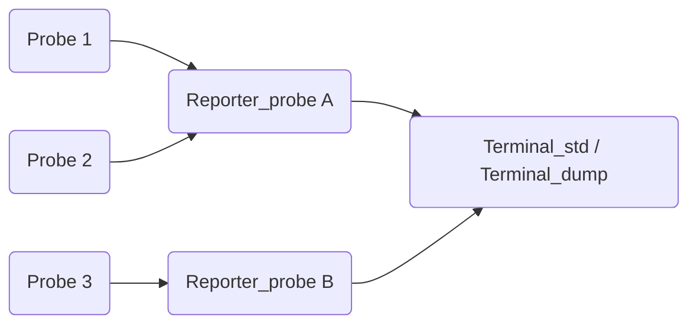

# Probes & Reporters

**Probes** are modules that measure values (throughput, latency, time,
counters, socket values, ...) while a sequence or a pipeline is running. Their
measures are collected by a **reporter** and displayed by a **terminal**,
either live or at the end of the execution.



## Probes

All the probes inherit from `module::AProbe` and have a single task named
`probe`. Each probe corresponds to **one column** of the report; its name is
the `col_name` given to the constructor. The probes are stateful modules
**without** `clone()`: their task cannot be replicated (a probe must be in a
sequence or pipeline stage executed by one thread).

| Probe | Constructor | Input socket | Measured value | Unit |
| ----- | ----------- | ------------ | -------------- | ---- |
| `Probe_latency` | `(col_name, reporter = nullptr)` | none | Time elapsed since the previous execution of the probe (or since `reset()`). | µs |
| `Probe_occurrence` | `(col_name, reporter = nullptr)` | none | Number of times the probe has been executed (per frame), starting at 0. | |
| `Probe_stream` | `(col_name, reporter = nullptr)` | none | Number of streams (executions of the task), starting at 0. | |
| `Probe_throughput` | `(data_size, col_name, factor, reporter = nullptr)`, `(data_size, col_name, reporter = nullptr)` or `(col_name, reporter = nullptr)` | none | `data_size × n_frames / factor` per second, measured since the previous execution. `factor` is `1024 × 1024` by default, `data_size` is 1 by default. | |
| `Probe_time` | `(col_name, reporter = nullptr)` | none | Time elapsed since the creation of the probe or the last `reset()`. | s (displayed `(sec)`) |
| `Probe_timestamp` | `(col_name, reporter = nullptr)` or `(mod, col_name, reporter = nullptr)` | none | Current `std::chrono::steady_clock` time (modulo `mod` if `mod > 0`). | µs |
| `Probe_value<T>` | `(size, col_name, reporter = nullptr)` | `in` (`T`, `size`) | The values of the input socket. | |

Enumerations: `module::prb::tsk::probe`, `module::prb::sck::probe::{in, status}`
(`Probe_value`) and `module::prb::sck::probe_noin::status` (other probes).

The probes without input socket are placed in the graph with a
[task-to-task binding](getting_started.md#task-to-task-binding), to define
when they are executed:

```cpp
prb_thr("probe") = relayer("relay");     // measure after the 'relay' task
prb_val["probe::in"] = relayer["relay::out"]; // record the values of a socket
```

!!! tip
    Call `reset()` on the probes right before the execution, so that the time
    references of `Probe_latency`, `Probe_throughput` and `Probe_time` are
    initialized:
    ```cpp
    for (auto& prb : seq.get_modules<module::AProbe>(false))
        prb->reset();
    ```

## Reporters

A `tools::Reporter_probe` groups several probes (= several columns) under a
title:

```cpp
tools::Reporter_probe(const std::string& group_name, const std::string& group_description);
explicit tools::Reporter_probe(const std::string& group_name);
```

The probes are registered either with the `reporter` parameter of their
constructor, with `probe.register_reporter(&reporter)`, or with:

```cpp
void register_probes(const std::vector<module::AProbe*>& probes);
```

A probe can only be registered with one reporter, and two probes of a reporter
cannot have the same column name. Each column stores the measures in a ring
buffer (100 streams by default); when the buffer is full, the new measures are
dropped until the reporter reads them.

The display of the columns can be customized, either per probe (through the
probe or the reporter) or for all the columns of a reporter:

| Per probe (`AProbe` method) | For all the columns (`Reporter_probe` method) | Description |
| --------------------------- | --------------------------------------------- | ----------- |
| `set_col_unit(unit)` | `set_cols_unit(unit)` | Unit displayed under the column name. |
| `set_col_buff_size(size)` | `set_cols_buff_size(size)` | Size of the ring buffer (in streams). |
| `set_col_fmtflags(ff)` | `set_cols_fmtflags(ff)` | `std::ios_base::fmtflags` (ex: `std::ios_base::scientific`). |
| `set_col_prec(prec)` | `set_cols_prec(prec)` | Precision of the displayed values. |
| `set_col_size(size)` | `set_cols_size(size)` | Width of the column. |

The per-probe methods require the probe to be registered first.

## Terminals

A terminal displays the measures of one or several reporters:

```cpp
explicit tools::Terminal_std (const std::vector<tools::Reporter*>& reporters);
explicit tools::Terminal_dump(const std::vector<tools::Reporter*>& reporters);
```

| Method | Description |
| ------ | ----------- |
| `legend(std::ostream& = std::cout)` | Prints the header (group titles, column names and units). |
| `temp_report(std::ostream& = std::cout)` | Prints the measures currently available. |
| `final_report(std::ostream& = std::cout)` | Stops the periodic report, then prints all the remaining measures. |
| `start_temp_report(std::chrono::milliseconds freq = 500ms)` | Starts a thread that calls `temp_report(std::clog)` every `freq`. |
| `stop_temp_report()` | Stops this thread. |

`Terminal_std` overwrites the same line at each temporary report (live
display), while `Terminal_dump` prints one line per measure (suited to a file).

!!! warning
    `final_report()` empties the buffers of the reporters, which may contain
    several measures per column. Only `Terminal_dump` supports this case:
    calling `final_report()` on a `Terminal_std` while several measures are
    pending leads to a crash. With `Terminal_std`, call `stop_temp_report()`
    then `temp_report()` to display the last measure, and use a
    `Terminal_dump` to get all the remaining measures.

## Example

The following example measures the throughput and the latency at the end of a
chain and displays them live in the terminal:

```cpp
const size_t n_elmts = 1024;
module::Initializer<float> ini(n_elmts);
module::Relayer<float> rly(n_elmts, 100000 /* ns */);
module::Finalizer<float> fin(n_elmts);
rly["relay::in"] = ini["initialize::out"];
fin["finalize::in"] = rly["relay::out"];

tools::Reporter_probe reporter("Measures", "at the end of the chain");
module::Probe_throughput prb_thr(n_elmts * sizeof(float), "THR", &reporter); // MiB/s (bytes / 2^20)
module::Probe_latency prb_lat("LAT", &reporter);                              // us
prb_thr("probe") = fin("finalize");
prb_lat("probe") = fin("finalize");

runtime::Sequence seq(ini("initialize"), 1); // the probes are not replicable: 1 thread

tools::Terminal_std terminal({ &reporter });
terminal.legend();
for (auto& prb : seq.get_modules<module::AProbe>(false))
    prb->reset();
terminal.start_temp_report(std::chrono::milliseconds(500)); // live display every 500 ms

std::atomic<size_t> counter(0);
seq.exec([&counter]() { return ++counter >= 10000; });

terminal.stop_temp_report();
terminal.temp_report(); // last measure
std::cout << std::endl;

// write all the measures still in the buffers in a file
tools::Terminal_dump dump({ &reporter });
std::ofstream file("probes.txt");
dump.legend(file);
dump.final_report(file);
```

The `tests/advanced/pipeline_probe.cpp` test shows a more complete example,
with probes in several stages of a pipeline and a `Terminal_dump` writing the
measures in a file.
