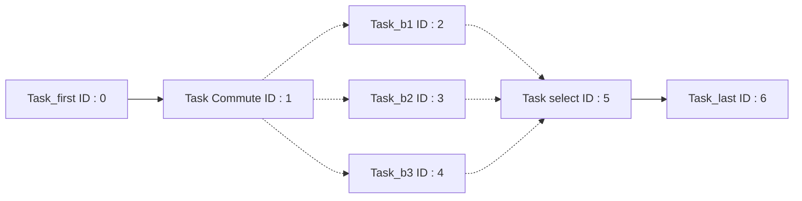
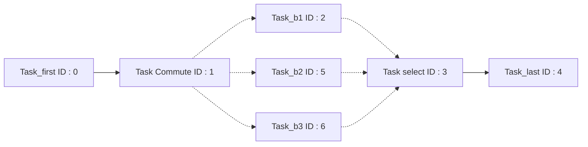
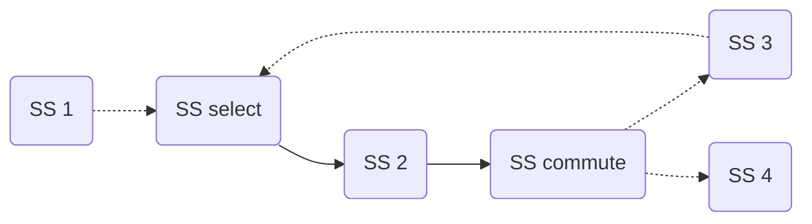

# Work in Progress

## Forward Socket with Control Flow

The no-copy rebinding of the `select` and `commute` tasks in `gen_processes()`
has historically not supported `SFWD` sockets bound directly on their data
sockets (only the first bound sockets were rebound). The current implementation
follows the forward sockets bound to the output data sockets with the
[`explore_thread_rec()`](sequence.md#Explore_thread_rec) function, but this
configuration is not covered by the tests yet. **For now, tasks bound to
switchers should use input and output sockets (`SIN`/`SOUT`, also called
`SIO`).**

## Task IDs Update

When `push` and `pull` tasks are inserted into the pipeline the 
`update_tasks_id()` method is called to assert that the task IDs are still 
coherent, the task with the greatest ID is used to insert the `push` task in 
stages for instance. It uses the following algorithm.

```python
# It is called with min_id = 0 in the pipeline code, min_id is shared between 
# recursive calls and NOT copied because it is a reference
void update_tasks_id(Node n, min_id):
    mark(n)
    for every task t in n:
        t.set_id(min_id)
        min_id += 1
    for every child c of n that is not marked:
        update_tasks_id(c, min_id)
```

This however can lead to issues. For instance when updating the IDs of a
sequence with a switch-case.

!!! warning
    The following is a graph of tasks, and NOT a graph of sub-sequences.



Here is the result of the DFS-id update.



This is not a coherent set of IDs, `Task_last` should not have an ID lower
than `Task_b2` and `Task_b3`, but due to the nature of the DFS algorithm it was
assigned a lower ID because it was reached first, thus `Task_b2` was updated
later and given a greater ID.

The current implementation (`Sequence::update_tasks_id()`) no longer uses a
global DFS numbering. Each sub-sequence keeps the identifier of its first task,
and the identifiers of the following tasks of the same sub-sequence are made
consecutive:

```python
void update_tasks_id(Node n):
    mark(n)
    first_id = n.tasks_id[0]
    for i, task in enumerate(n.tasks):
        n.tasks_id[i] = first_id + i
    for every child c of n that is not marked:
        update_tasks_id(c)
```

This keeps the identifiers of the tasks that were already in the sequence and
gives consecutive identifiers to the tasks inserted at the end of a
sub-sequence (the `push` tasks). The drawback is that an inserted task may get
an identifier that is already used in another sub-sequence. A better long term
solution would perhaps be to use the `min_id` system in order to keep the old
numerical values of already existing tasks but with a breadth-first type
algorithm.

<a name="End-of-sequence"></a>
## End-of-sequence (`commute`/`select`)

Currently a sequence may not end with a switcher task (`commute` or `select`), 
this is problematic for pipelines as this means that individual stages cannot 
have a commute as their last task. This would require modifications to the 
`get_last_subsequence()` method, as an end-of-sequence commute would still have
children.

### Example

As an example, let's try to divide the following sequence into 3 stages



=== "Stage 1"
    ```mermaid
    graph LR;
    A(SS1);
    ```

=== "Stage 2"
    ```mermaid
    graph LR;
    B(SS select)-->C(SS 2);
    C(SS 2)-->F(SS commute);
    F(SS commute)-.->E(SS 3);
    E(SS 3)-.->B(SS select);
    ```

=== "Stage 3" 
    ```mermaid
    graph LR;
    G(SS 4);
    ```

With our current implementation of the DFS, Stage 2 technically has no final
sub-sequence as every single node has at least one child, thus making the 
insertion of push tasks impossible. A solution would be to introduce a fake task 
after each commute on their last path during pipeline creations.
